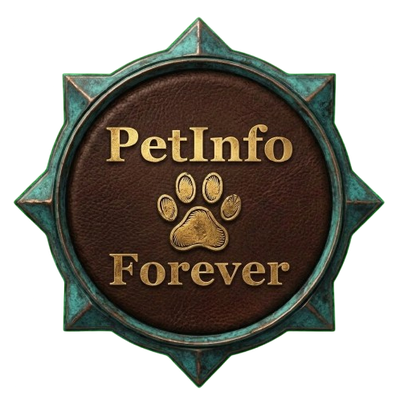

<p align="center"></p>

# ForeverHunterPetInfo

**What a hunter wants to know about a beast before taming it, for World of
Warcraft: Forever.**

Hover a beast and its tooltip tells how fast it will attack as your pet, its
family, what it eats and the abilities it teaches. A window lists every beast
and searches them by name, family, zone, ability, rank and attack speed.
No dependencies: the data ships with the addon.

## Features

### Beast tooltips

- **Attack speed**, with the passive that gives it (*Faster Attack V*).
- **Family and diet**, optionally as icons.
- **The abilities the beast teaches**, with their rank.
- Optionally the family's damage, armor and health bonus, and the abilities
  the family can learn.
- **Pets of other hunters** show the beast they were tamed from, with its
  level and zone.
- A creature the addon has no data for still gets what is true of its family.

### Beast list

- Search by any part of a name, family, zone or ability. Several words must
  all match: `wolf barrens`.
- Filter by family, by the ability a beast teaches and its rank, by the
  slowest attack speed you accept, and to the beasts you can tame at your level.
- Sort by name, attack speed or level.
- Show only what was noted in game: the new beasts and the confirmed abilities.
- Shift-click a beast to write its name and position in the chat.

### It learns as you play

The shipped families are those of Forever. The beasts, their attack speeds and
the abilities they teach are those of Classic, for the 550 beasts that are
still in the game.

- **A beast that is not shipped** (Forever added more than a hundred) is noted
  as soon as it is near you: when its nameplate appears, when you target it
  or hover it. Its family, level and zone are kept, a line in the chat tells
  you so, and it is listed from then on.
- **Cast Beast Lore on a beast and hover it**: the abilities its tooltip then
  lists are noted as what it teaches, without taming it.
- **When you tame a beast**, what your new pet knows and how fast it attacks
  is noted as what that beast teaches. It replaces the Classic data and is
  marked as confirmed.
- **Family names** are picked up from the client, so the addon recognizes
  families in every language.

All of it is kept in `ForeverHunterPetInfoDB`, for the whole account.

## Usage

Click the minimap button, or use a command:

| Command | |
| --- | --- |
| `/fhpi` | Open or close the beast list |
| `/fhpi <text>` | Search the beasts |
| `/fhpi options` | Open the options |
| `/fhpi tooltip` | Show or hide the information in tooltips |
| `/fhpi minimap` | Show or hide the minimap button |
| `/fhpi help` | List the commands |

`/hpi` and `/hunterpetinfo` do the same. Other addons and macros can call
`ForeverHunterPetInfo.Toggle()`, `ForeverHunterPetInfo.Search(text)` and
`ForeverHunterPetInfo.GetBeast(npcId)`.

## Known limits

- In combat and in instances, the game hides from addons which unit a tooltip
  is of. The tooltip then stays as the game made it.
- The abilities that are new in Forever (Swipe, Web, Sonic Blast...) are not
  in the shipped data: a beast is only known to teach one once you cast
  Beast Lore on it or tamed it.
- Nameplates must be shown for the beasts around you to be noted without
  hovering or targeting them. Nothing is noted in combat, when the game hides
  what a unit is.
- A beast is noted as tamed when a pet appears after Tame Beast was cast. If
  you teach it something within the second that follows, that is noted too.
- The interface is in English. Beast and zone names are in your language.

## Releases

Pushing a tag publishes a release: the tests run, then the
[BigWigs packager](https://github.com/BigWigsMods/packager) builds the zip,
fills in the version, and uploads it to GitHub and CurseForge.

```sh
git tag v1.0.0        # v1.0.0-beta1 for a beta, v1.0.0-alpha1 for an alpha
git push origin v1.0.0
```

It needs the `CF_API_TOKEN` secret in the repository, and the CurseForge
project's ID in the TOC, as `## X-Curse-Project-ID`.

## Development

```
ForeverHunterPetInfo/   the addon
  Core/                 lookups, the learner, tooltips, slash commands
  UI/                   beast list, options, minimap button
  Data/                 families (by hand), generated beast data
  Locales/              interface translations
  Media/                logo
docs/                   logo
tools/                  data generator
tests/                  offline test harness
```

`tools/gen_data.py` regenerates `Data/Beasts.lua` and `Data/BeastNames.lua`
from a Forever AddOns folder that holds QuestieDB, and a copy of
ClassicHunterPetInfo. `tests/harness.py` loads the addon in Lua 5.1 against a
stubbed WoW API and runs a scenario over the tooltips, the learner, the search
and the window:

```sh
pip install cbor2 lupa
python3 tools/gen_data.py "<Forever Interface/AddOns>" "<ClassicHunterPetInfo folder>" ForeverHunterPetInfo/Data
python3 tests/harness.py          # enUS
python3 tests/harness.py deDE     # any other locale
```
