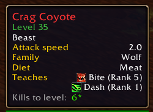
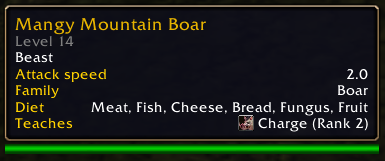
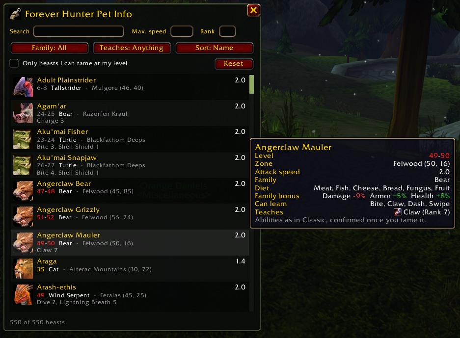

# Forever Hunter Pet Info

**What a hunter wants to know about a beast before taming it, for World of Warcraft: Forever.**

Is that cat one of the fast ones? Which wolf teaches the next rank of Bite, and where does it live? Forever Hunter Pet Info answers that in the beast's tooltip, and in a searchable list of every beast.

It has **no dependencies**. The data ships with the addon.

## What it does

### Beast tooltips

Hover a beast and its tooltip also shows:

- **how fast it will attack as your pet**, with the passive that gives it (*Faster Attack V*),
- **its family and what it eats**, as text or as icons,
- **the abilities it teaches**, with their rank,
- optionally the family's damage, armor and health bonus, and the abilities the family can learn.

The **pets of other hunters** show the beast they were tamed from, with its level and zone, so you can go and tame the same. Every part can be turned off in the options.

### A searchable beast list

Open it from the minimap button or with `/fhpi`.

- **Search** by any part of a name, family, zone or ability. `/fhpi wolf barrens` lists the wolves of the Barrens.
- **Filter** by family, by the ability a beast teaches and its rank, and by the slowest attack speed you accept.
- **Only the beasts you can tame at your level**: Forever does not let you tame a beast above your own.
- **Sort** by name, attack speed or level.
- Shift-click a beast to write its name and position in the chat.

### It learns as you play

The families are those of Forever. The beasts, their attack speeds and the abilities they teach are those of Classic, for the 550 beasts that are still in the game. What Forever changed, the addon picks up in game:

- **New beasts near you** are noted when their nameplate appears, when you target or hover them, with their family, level and zone. A line in the chat tells you so, and they are listed from then on.
- **Cast Beast Lore on a beast and hover it**: the abilities its tooltip lists are noted as what it teaches.
- **Tame a beast**: what your new pet knows and how fast it attacks is noted, and marked as confirmed.

## Commands

| Command | |
| --- | --- |
| `/fhpi` | Open or close the beast list |
| `/fhpi <text>` | Search the beasts |
| `/fhpi options` | Open the options |
| `/fhpi tooltip` | Show or hide the information in tooltips |
| `/fhpi minimap` | Show or hide the minimap button |

`/hpi` and `/hunterpetinfo` do the same.

## Good to know

- In combat and in instances, the game hides from addons which unit a tooltip is of. The tooltip then stays as the game made it.
- The abilities that are new in Forever (Swipe, Web, Sonic Blast...) are not in the shipped data: a beast is known to teach one once you cast Beast Lore on it or tamed it.
- The interface is in English. Beast and zone names are in your language.

## Credits

The idea follows ClassicHunterPetInfo by Spielstein. Beast names, levels and zones are derived from QuestieDB. See `NOTICE.md` in the addon folder. Source and issues: [GitHub](https://github.com/simsekahmett/hunterpetinfo-forever).
